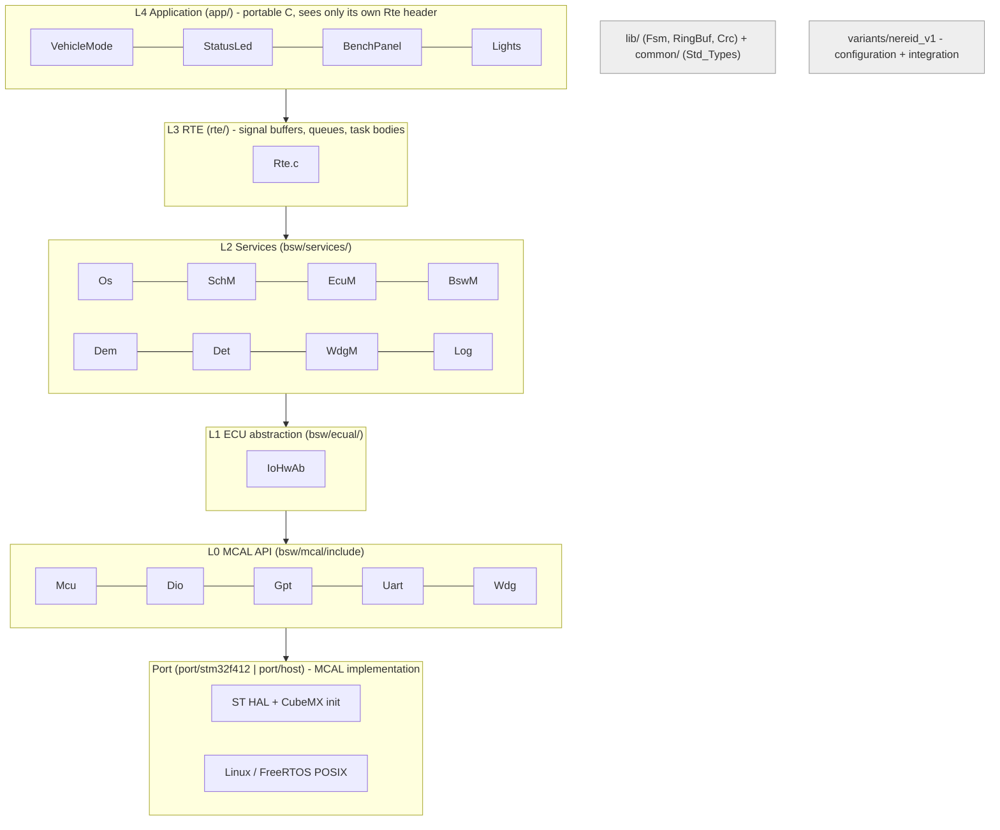
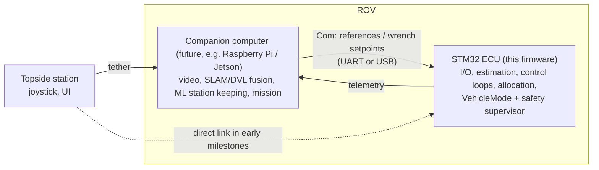

# ECU Firmware Architecture

Status: **baseline for milestones M0/M1** (see [`docs/project/roadmap.md`](../project/roadmap.md)).
Code: [`firmware/`](../../firmware). Decisions: ADR-004 … ADR-008 in [`docs/decisions/`](../decisions).

## 1. Goals and constraints

| Goal | Consequence for the design |
|---|---|
| Reuse on another ROV without rewriting | Vehicle specifics live only in a **variant** (`variants/<rov>/`); MCU specifics only in a **port** (`port/<mcu>/`). |
| Behaviour expressed as **state machines** | One small hierarchical state machine engine (`lib/Fsm`), used by EcuM, VehicleMode and Lights, and later by drivers and Com. |
| Safety before features | Propulsion permission has exactly one owner (VehicleMode); faults are classified centrally (Dem); a hardware watchdog supervises task liveness (WdgM). |
| Testable without hardware | Everything above the MCAL compiles for Linux. Unit tests run per module; the complete ECU runs on the FreeRTOS POSIX port (the basis for SIL). |
| Solo developer | AUTOSAR *concepts and naming* without AUTOSAR *tooling*: no ARXML, no generators, hand-written RTE. |
| Room for future AI / station keeping | Compute partitioning (§10): learning-based control runs as an SWC behind the controller interface, or on a companion computer that is just another command source. |

Target: NUCLEO-F412ZG, STM32F412ZG Cortex-M4F at 96 MHz, 1 MB flash, 256 KB SRAM, FreeRTOS V11.

## 2. Layer model

The model is AUTOSAR Classic *inspired*. It keeps the layer names, but it is **not** AUTOSAR compliant.



### 2.1 Dependency rules

| Layer | May include | Enforced by |
|---|---|---|
| `app/<Swc>` | its own headers, `rte/include`, `lib/`, `common/` | CMake (the SWC target cannot see BSW include paths) + `check_layers.py` |
| `rte/` | app, services, ecual, Det, variant config, lib | `check_layers.py` |
| `bsw/services` | services, ecual, mcal, Det, variant config, lib. **FreeRTOS headers only in `Os.c`** | `check_layers.py` |
| `bsw/ecual` | mcal, Det, variant config, lib | `check_layers.py` |
| `bsw/mcal/include` | variant config (`*_Cfg.h`), common | `check_layers.py` |
| `port/<mcu>` | mcal, lib, vendor (HAL/CMSIS/POSIX), FreeRTOS config | CMake + `check_layers.py` |
| `lib/` | common only | CMake + `check_layers.py` |
| `variants/<rov>` | anything (it is the integration layer) | - |

Two cross-cutting services may be called from any BSW layer: **Det** (development errors)
and **Log**. That matches AUTOSAR, where Det is reachable from every BSW module.

Run `python3 firmware/tools/check_layers.py` locally. CI runs it on every push.

### 2.2 Why these layers pay off

- **Changing the vehicle** (thruster count, pins, limits, which sensors) only touches `variants/`.
- **Changing the MCU** (e.g. moving to an STM32H7, or an RP2040 on a small ROV) means a new
  `port/<mcu>/` that implements the MCAL headers, plus the variant's pin tables.
- **Changing the RTOS** only touches `bsw/services/Os/src/Os.c` (ADR-004).
- **Changing the topside link** (UART, RS-485, Ethernet via companion) only touches the
  transport below Com (M2). Com and the SWCs stay the same.

## 3. Module catalogue

| Module | Layer | Responsibility | Status |
|---|---|---|---|
| `Std_Types`, `ModuleIds` | common | `Std_ReturnType`, `E_OK`, module IDs | done |
| `Fsm` | lib | hierarchical state machine engine | done, tested |
| `RingBuf` | lib | SPSC byte ring buffer | done, tested |
| `Crc` | lib | CRC-16/CCITT-FALSE | done, tested |
| `Pid`, `MathLib` (quaternion, saturation) | lib | control primitives | M5 |
| `Mcu` | MCAL | reset cause, software reset | done |
| `Dio` | MCAL | digital I/O by logical channel | done |
| `Gpt` | MCAL | 1 MHz free-running time base (TIM2) | done |
| `Uart` | MCAL | byte streams, blocking TX, IRQ RX | done (RX unused until M2) |
| `Wdg` | MCAL | independent watchdog (IWDG) | done |
| `Pwm`, `Adc`, `I2c`, `Spi`, `Flash` | MCAL | ESCs, battery, sensors, NvM | M3/M4/M6 |
| `IoHwAb` | ECUAL | logical signals, polarity, debouncing | done, tested |
| `ComIf`, `Esc_*`, `Imu_*`, `Press_*` | ECUAL | transport and device drivers | M2/M3/M4 |
| `Os` | services | FreeRTOS wrapper: static periodic tasks, critical sections, time | done |
| `SchM` | services | creates the variant's task table, measures execution time and overruns | done |
| `EcuM` | services | start-up init lists, ECU state machine, fatal error hook | done |
| `BswM` | services | arbitration: fault class, self-test, shutdown permission | done |
| `Det` | services | development error reporting | done |
| `Dem` | services | debounced, classified, latched fault events | done, tested |
| `WdgM` | services | alive supervision → IWDG | done, tested |
| `Log` | services | non-blocking ring-buffered logging | done |
| `Com`, `ComM` | services | versioned telemetry/command protocol, link state machine | M2 |
| `NvM` | services | parameters in flash with CRC | M6 |
| `VehicleMode` | app | operating modes and propulsion permission | done, tested |
| `StatusLed` | app | mode/fault indication | done, tested |
| `BenchPanel` | app | user button → operator requests (bench only) | done, tested |
| `Lights` | app | lights state machine | done, tested |
| `PilotCmd`, `StateEst`, `DepthCtrl`, `HeadingCtrl`, `ThrustAlloc`, `LeakMon`, `PowerMon` | app | see roadmap | M2–M6 |

## 4. Naming and API conventions

- Public functions are named `<Module>_<Verb><Object>()`, for example `Dem_SetEventStatus` or `IoHwAb_GetDigitalInput`.
- Cyclic entry points are `<Module>_MainFunction()`. Initialisation is `<Module>_Init(const <Module>_ConfigType *cfg)`, where the module has configuration.
- Return `Std_ReturnType` (`E_OK` / `E_NOT_OK`) and pass results back through out-pointers.
- Configuration headers are named `<Module>_Cfg.h`, and configuration data `<Module>_Cfg.c`. Both live in the variant.
- RTE ports:
  - `Rte_Read_<Swc>_<Port>()` and `Rte_Write_<Swc>_<Port>()` for data.
  - `Rte_Call_<Swc>_<Op>()` for client/server calls.
  - Queued reads return `RTE_E_NO_DATA` when empty.

See [`coding_standard.md`](coding_standard.md) for the full rules.

## 5. RTE

The RTE (`rte/src/Rte.c`) is hand-written and is the **only** file that knows both SWCs and BSW.

- **Sender/receiver data** (mode, propulsion enable, authority limit) is held in static variables, last-is-best.
- **Queued data** (operator requests, light requests) goes into small ring buffers. Writes are serialised with `Os_EnterCritical` because there can be more than one sender: BenchPanel now, Com from M2.
- **Client/server**: for example `Rte_Call_VehicleMode_ClearFaults()` → `Dem_ClearAllEvents()`.
- **Task bodies**: `Rte_Task_Control10ms()` and `Rte_Task_Bsw100ms()` fix the runnable order (§6).
- **Bench stubs**: `Rte_Read_VehicleMode_ArmingInputs()` contains clearly marked stubs. They stand in for inputs that don't exist yet (link freshness, estimator, battery, leak). **Thrusters must not be connected while those stubs exist.** Each stub names the milestone that replaces it.

SWC unit tests replace the RTE with a fake (see `tests/unit/test_vehiclemode.c`). That is the
main practical benefit of the RTE boundary.

## 6. Tasks and timing

Tasks are strictly periodic AUTOSAR-OS-style basic tasks. They are created by SchM from the
variant table (`variants/nereid_v1/src/SchM_Cfg.c`) and run on `vTaskDelayUntil`.

| Task | Period | Priority | Runnables, in order | Budget (to be measured) |
|---|---|---|---|---|
| `Control10ms` | 10 ms | 5 (highest) | WdgM checkpoint → IoHwAb → BswM → BenchPanel → VehicleMode → Lights → *(M3+: StateEst → controllers → ThrustAlloc → outputs)* | ≤ 2 ms |
| `Comm` *(M2)* | 20 ms + RX event | 4 | ComIf RX → Com decode → Rte queues; telemetry encode → TX | ≤ 3 ms |
| `Bsw100ms` | 100 ms | 2 | StatusLed → EcuM → WdgM supervision → Log drain | ≤ 50 ms (UART-bound) |

- **Execution time**: SchM measures every activation with Gpt (last/max µs per task, `SchM_GetTaskStats`). These numbers go into telemetry in M2 and replace the "to be measured" column.
- **Overrun**: a missed deadline (`xTaskDelayUntil` returns `pdFALSE`) reports `DEM_EVENT_TASK_OVERRUN` and is logged.
- **Starvation / hang**: WdgM expects 8–12 control-task checkpoints per 100 ms. Two bad windows stop the watchdog trigger, and the IWDG (500 ms nominal) resets the MCU. This was verified on the host build: forcing the supervision to fail gave `Dem WDGM_SUPERVISION FAILED` → fault class FAILSAFE → `supervision expired` → `WATCHDOG RESET` once the 500 ms timeout ran out.
- **Interrupts**: only short ISRs that push into ring buffers. Any ISR that calls FreeRTOS APIs needs priority ≥ 5 (`configMAX_SYSCALL_INTERRUPT_PRIORITY`).
- No blocking calls in `Control10ms`. Blocking UART output happens only in `Bsw100ms`, through Log.

## 7. Start-up and shutdown (EcuM)

```
Reset → CubeMX: HAL_Init, SystemClock_Config, MX_GPIO/USART init
      → EcuM_Init()
          InitListZero  : Mcu, Det, Gpt, Dio, Uart, Log, Dem        (no OS yet)
          reset reason  : watchdog reset → Dem WATCHDOG_RESET (advisory, latched)
          InitListOne   : IoHwAb (outputs safe) → BswM → Rte_Start (SWC inits)
                          → WdgM (starts IWDG) → SchM (creates tasks)
          STARTUP → RUN
          Os_Start()  (never returns)
```

- **Shutdown or reset** is requested with `EcuM_RequestReset()`. It runs only when `BswM_IsShutdownAllowed()` is true, i.e. propulsion is inhibited. Then: outputs safe → flush log → `Mcu_PerformReset()`.
- **Fatal errors** (OS assert, stack overflow, failed init) go to `EcuM_ErrorHook`: outputs safe → log → reset.
- **HardFault** resets immediately. After reset all GPIOs are inputs and PWM stops, which is the safe state.

## 8. Error handling

| Mechanism | Use for | Effect |
|---|---|---|
| **Det** | programming errors (bad ID, null pointer, call before init) | log + `DEM_EVENT_DEV_ERROR` (advisory) |
| **Dem** | operational faults (sensor stale, leak, overrun, supervision) | debounced event, classified ADVISORY / DEGRADED / FAILSAFE / EMERGENCY, optionally latched |
| **BswM → VehicleMode** | reaction | worst active class drives mode transitions (state_machines.md) |
| **WdgM / IWDG** | lost liveness | reset |
| **EcuM_ErrorHook** | unrecoverable software state | safe outputs, reset |

Fault classes and their reactions are the firmware implementation of the safety case's fault
response matrix ([`safety_case.md` §4](../safety/safety_case.md)). The event table lives in
`variants/nereid_v1/src/Dem_Cfg.c`.

## 9. Configuration and variants

```
variants/nereid_v1/
  include/  Dio_Cfg.h  Uart_Cfg.h  IoHwAb_Cfg.h  Dem_Cfg.h  WdgM_Cfg.h  Swc_Cfg.h  Variant_Cfg.h
  src/      IoHwAb_Cfg.c  Dem_Cfg.c  WdgM_Cfg.c  SchM_Cfg.c  EcuM_Cfg.c  Swc_Cfg.c
  stm32f412/Dio_PBcfg.c        (MCU-specific pin tables)
```

Today this is compile-time (pre-compile) configuration. From M6, tunable values such as gains,
limits and thruster maps move to NvM parameters, generated from the single parameter source in
`config/` (ADR-002).

### 9.1 Porting guide: a new ROV

1. Copy `variants/nereid_v1` to `variants/<new_rov>`.
2. Edit the logical channels (`Dio_Cfg.h`, `IoHwAb_Cfg.h`), the pin tables (`<mcu>/Dio_PBcfg.c`), the task table, the Dem classification and the SWC calibration (`Swc_Cfg.c`).
3. Build with `-DNEREID_VARIANT=<new_rov>`.
4. Run the host tests. They are variant-independent except where a test supplies its own config.

### 9.2 Porting guide: a new MCU

1. Create `port/<mcu>/` and implement every header in `bsw/mcal/include` there.
2. Add `FreeRTOSConfig.h` (it includes `FreeRTOSConfig_Common.h`), a linker script and a `<mcu>.cmake`.
3. Add `variants/<rov>/<mcu>/` pin tables.
4. Bring the port up in order: Gpt and Dio (LED heartbeat) → Uart (log) → Wdg → the rest.

## 10. Compute partitioning, AI and station keeping



Rules:

1. **The ECU is always the safety authority.** Any command source (topside joystick, companion computer, an on-board model) goes through the same Com → Rte → VehicleMode path. Each one is subject to freshness timeouts, authority limits and the arming guards. Nothing writes actuators directly.
2. **Heavy models run on the companion computer.** Vision, SLAM, DVL fusion and ML policies need Linux, memory and accelerators. This is the same split Blue Robotics uses: ArduSub on a flight controller, plus a companion computer running BlueOS.
3. **Small models may run on the ECU** as an app SWC (`AiCtrl`) behind the ADR-003 controller interface. Examples: a learned disturbance observer, or a small MLP residual policy, a few kB of weights, with TensorFlow Lite Micro or CMSIS-NN on the M4F. They get the same saturation, rate limits and fallback-to-PID behaviour as any controller. The F412's 256 KB RAM is the practical limit, so measure before committing.
4. Station keeping needs a horizontal position or velocity reference (DVL, USBL, vision). IMU and pressure alone can't provide one (`state_estimation.md` §6). That sensor decision drives where the estimator runs.

## 11. Build and test

The commands are in [`firmware/README.md`](../../firmware/README.md). In summary:

- **Host preset**: unit tests for every tested module, plus a smoke test that boots the complete ECU on the FreeRTOS POSIX port and drives a scripted button sequence through all modes.
- **Target presets**: cross build for the NUCLEO-F412ZG. This needs the one-time CubeMX regeneration (`port/stm32f412/cubemx/README.md`).
