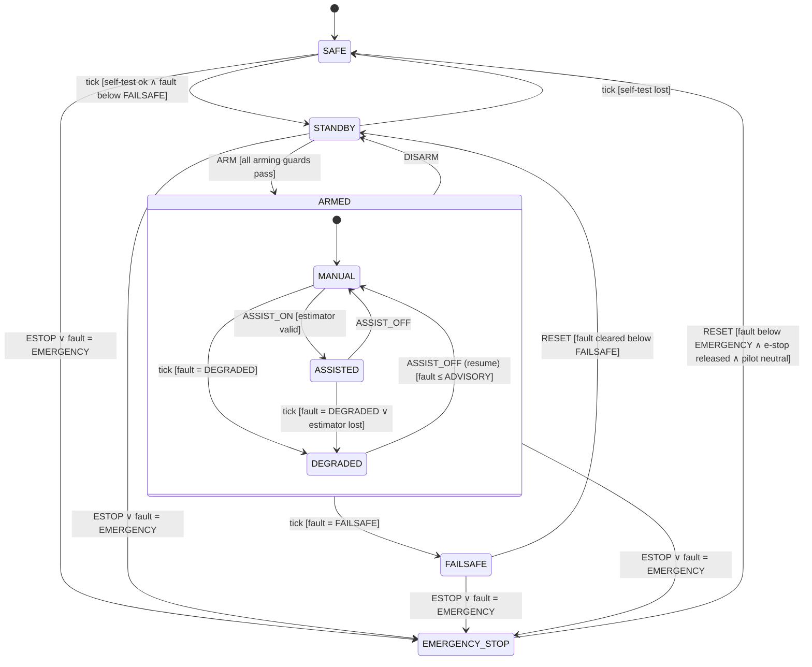
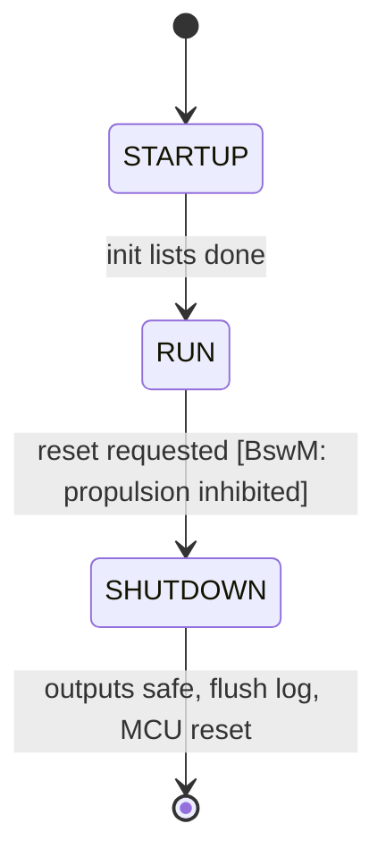
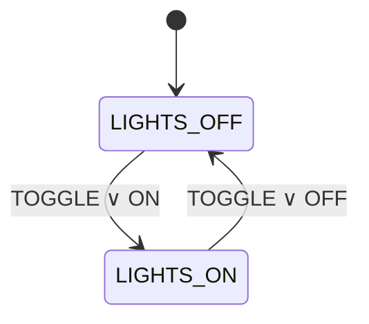

# State Machines

All state machines run on the project's hierarchical state machine engine
[`lib/Fsm`](../../firmware/lib/Fsm/include/Fsm.h) (ADR-006). It works as follows:

- Each state is a constant descriptor with an optional parent, an initial child, entry and exit actions, and an event handler.
- An event is offered to the active leaf first, then to each ancestor in turn (UML "bubbling").
- Transitions are *external*: exit up to the common ancestor, enter down to the target, then follow `initial` children.
- Each event runs to completion. There is no dynamic memory and the nesting depth is bounded (8).

Diagrams use Mermaid `stateDiagram-v2`, which renders on GitHub and in Obsidian.
The "Test" column links behaviour to `firmware/tests/unit`.

---

## VehicleMode

**Owner:** `app/VehicleMode`. This is the vehicle's top-level operating mode and the **only**
component that grants propulsion.

**Inputs:**

- operator requests (queued)
- worst active fault class (Dem via BswM)
- arming inputs: self-test, command freshness, estimator, battery, leak, pilot neutral, e-stop released

**Outputs:**

- `Mode`
- `PropulsionEnable` (true **only** inside ARMED, set by ARMED's entry/exit actions)
- `AuthorityLimit` (0…1)
- `ArmRejectReason` (a bit mask of the failed guards)

The ESTOP transition is implemented once, in the root state, so it is reachable from every
state. EMERGENCY_STOP absorbs every other event, which makes it **latched**.

### Cycle (10 ms runnable)

Each 10 ms cycle runs these steps in order:

1. Read inputs.
2. If the fault class is EMERGENCY, dispatch ESTOP. This pre-empts everything else in the cycle.
3. Dispatch up to 4 queued operator requests.
4. Dispatch `TICK`. This evaluates fault classes and guards as *levels*, so a fault can't be missed the way an edge can.
5. Publish the outputs.

### Arming guards

These come from [`system_overview.md` §5](../architecture/system_overview.md).

| Guard bit | Condition to arm | Source (milestone) |
|---|---|---|
| `SELF_TEST` (0x01) | EcuM in RUN, configuration valid | BswM (now) |
| `COMMAND_STALE` (0x02) | operator link fresh | Com heartbeat (M2), stub `true` until then |
| `ESTIMATOR` (0x04) | state estimate valid | StateEst (M4), stub |
| `BATTERY` (0x08) | battery within limits | PowerMon (M6), stub |
| `LEAK` (0x10) | no leak detected | LeakMon (M6), stub |
| `PILOT_INPUT` (0x20) | pilot axes neutral | PilotCmd (M2), stub |
| `FAULT_ACTIVE` (0x40) | worst fault < DEGRADED | Dem (now) |

A rejected ARM keeps STANDBY and publishes the mask. RTE logs it as `ARM rejected, failed guards 0x….`.

### Transition table

| From | Event [guard] | To | Test |
|---|---|---|---|
| SAFE | TICK [self-test ∧ fault < FAILSAFE] | STANDBY | `test_safe_to_standby_when_self_test_passed`, `test_safe_stays_*` |
| STANDBY | TICK [¬self-test] | SAFE | `test_standby_falls_back_to_safe_when_self_test_lost` |
| STANDBY | ARM [guards] | ARMED.MANUAL | `test_arm_with_all_guards_enters_manual`, `test_each_failed_guard_blocks_arming` |
| ARMED.* | DISARM | STANDBY | `test_disarm_from_every_armed_substate` |
| MANUAL | ASSIST_ON [estimator] | ASSISTED | `test_assist_on_and_off`, `test_assist_rejected_without_estimator` |
| ASSISTED | TICK [¬estimator] | DEGRADED | `test_estimator_loss_in_assisted_degrades` |
| ARMED.* | TICK [fault = DEGRADED] | DEGRADED | `test_degraded_fault_while_armed_degrades` |
| DEGRADED | ASSIST_OFF [fault ≤ ADVISORY] | MANUAL | `test_resume_from_degraded_only_when_fault_gone` |
| ARMED.* | TICK [fault = FAILSAFE] | FAILSAFE | `test_failsafe_fault_from_every_armed_substate` |
| FAILSAFE | RESET [after clear: fault < FAILSAFE] | STANDBY | `test_failsafe_reset_requires_fault_gone`, `test_rearm_after_failsafe_needs_deliberate_arm` |
| any | ESTOP, or fault = EMERGENCY | EMERGENCY_STOP | `test_estop_request_from_every_state`, `test_emergency_fault_*` |
| EMERGENCY_STOP | RESET [fault < EMERGENCY ∧ e-stop released ∧ pilot neutral] | SAFE (→ STANDBY via self-test) | `test_estop_reset_conditions`, `test_estop_is_latched` |

**Invariant**, asserted after every cycle in every test: `PropulsionEnable ⇔ mode ∈ ARMED_*`.
Outside ARMED the authority is 0.

### Authority per mode (variant `Swc_Cfg.c`)

| Mode | Authority | Propulsion |
|---|---|---|
| ARMED_MANUAL | 1.0 | yes |
| ARMED_ASSISTED | 1.0 | yes |
| ARMED_DEGRADED | 0.5 | yes |
| all others | 0.0 | **no** |

### Deliberate design choices

- **No automatic recovery to a higher-authority mode.** DEGRADED → MANUAL and FAILSAFE → STANDBY both need an operator request, as `safety_case.md` §3 requires: "Re-arming after critical fault shall require deliberate operator action".
- **RESET clears faults first** (`Rte_Call_VehicleMode_ClearFaults` → `Dem_ClearAllEvents`, which only un-latches faults whose condition has gone), then re-evaluates the guards.
- **MISSION** (from the system overview) is not implemented. It will become a further ARMED sub-state guarded by a variant flag when autonomous guidance exists (M8).
- **POWER_OFF** is a physical state, not a software state.

---

## EcuM (ECU state)

**Owner:** `bsw/services/EcuM`.

Fatal errors bypass this machine through `EcuM_ErrorHook` (outputs safe → log → reset).

---

## Lights

**Owner:** `app/Lights`. This formalises the original "Hand Controller Unit – Lights" sketch.
The state itself is the memory, so no separate "previous state" variable is needed. Entry
actions drive the output.

ON in ON and OFF in OFF are ignored, so the requests are idempotent. Requests arrive from the
topside through Com (M2). In M3, `LIGHTS_ON` becomes a composite state with dimming sub-states
once a PWM output exists. Tests: `test_lights.c`.

---

## BenchPanel (user button)

**Owner:** `app/BenchPanel`. This is for bench use only, until the topside link exists.

| Gesture | Mode | Request |
|---|---|---|
| hold ≥ 1 s | any | ESTOP (fires while held, once) |
| short press (≥ 30 ms) | STANDBY | ARM |
| short press | ARMED_* | DISARM |
| short press | FAILSAFE, EMERGENCY_STOP | RESET |
| short press | SAFE | none |

---

## Status indication

**Owner:** `app/StatusLed`. Patterns are 16 steps × 100 ms (1.6 s).
On the Nucleo, green is LD1 and red is LD3. The blue LD2 stands in for the vehicle lights.

| Mode | Green | Red |
|---|---|---|
| SAFE | fast blink (5 Hz) | – |
| STANDBY | short heartbeat | – |
| ARMED_MANUAL | solid | – |
| ARMED_ASSISTED | solid with a gap | – |
| ARMED_DEGRADED | solid | slow blink |
| FAILSAFE | – | blink |
| EMERGENCY_STOP | – | solid |
| any, with an active ADVISORY-or-worse fault and no red pattern | | short blip |

---

## Planned machines

| Machine | States | Milestone |
|---|---|---|
| CommLink (ComM) | DISCONNECTED → CONNECTED → STALE → DISCONNECTED; STALE raises a Dem event (FAILSAFE class) | M2 |
| Sensor drivers | INIT → CONFIGURE → RUN → FAULT (retry with back-off) | M4 |
| ESC output | DISABLED → ARMING (neutral for the ESC arming time) → ACTIVE; any loss of `PropulsionEnable` → DISABLED | M3 |
